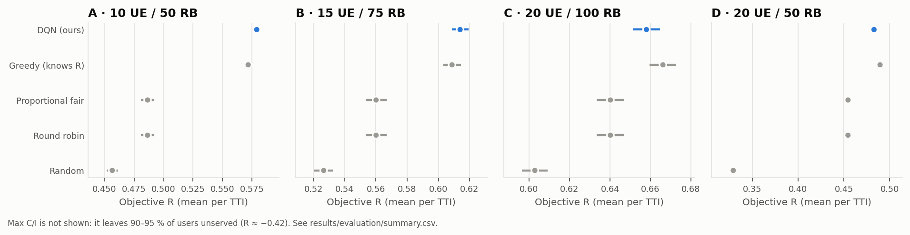
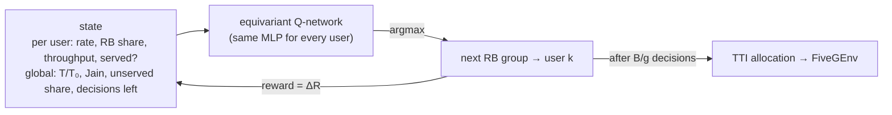
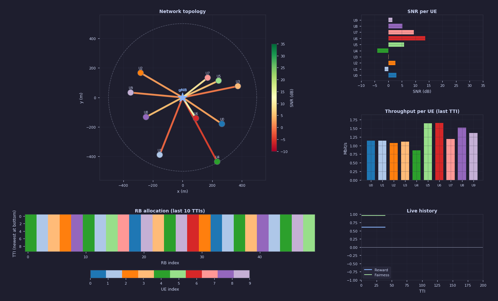

# DRL-Based 5G Resource-Block Scheduling

[](https://github.com/breksos/DRL-Based-5G-Simulation/actions/workflows/ci.yml)


A single-cell 5G downlink simulator in which a **Double-DQN agent learns to
assign resource blocks to users**. It is compared with classical schedulers on
the same 500 random cell layouts per scenario, with confidence intervals.
The repo ships a live Tkinter dashboard, an installable Python package, a CLI,
trained models, and the scripts that regenerate every number and figure below.



## Results

| Scenario | Round robin | Prop. fair | Greedy (knows R) | **DQN** | DQN vs round robin | DQN − Greedy (paired) |
|---|---|---|---|---|---|---|
| A | 0.486 | 0.486 | 0.572 | **0.579** | +19.0 % | +0.0073 ± 0.0024 |
| B | 0.560 | 0.560 | 0.609 | **0.614** | +9.6 % | +0.0052 ± 0.0021 |
| C | 0.640 | 0.640 | **0.666** | 0.658 | +2.8 % | -0.0081 ± 0.0009 |
| D | 0.455 | 0.455 | **0.490** | 0.483 | +6.3 % | -0.0066 ± 0.0005 |

`R` is the mean per-TTI objective (defined below) over 500 cell layouts that
every scheduler shares: 5 seeds × 100 UE drops, 200 TTIs each. The last
column is the paired difference to the greedy reference, with its 95 %
confidence interval.

* **The DQN beats every scheduler that does not know the reward function, in
  all four scenarios:** +2.8 % to +19.0 % over round robin and proportional
  fair.
* **It is level with a greedy allocator that computes `R` in closed form.**
  It is ahead in A and B and 1.2–1.3 % behind in C and D. Three training seeds
  in scenario A land within 0.0023 of each other.
* **The original course objective rewards starving users.** Trained without
  the minimum-service term, the agent leaves 21 % of users with nothing
  ([ablation](docs/RESULTS.md#ablation-the-original-objective-rewards-starvation)).

## How it works

**The cell.** One gNB serves 10–20 users dropped uniformly over a 500 m cell.
Each RB is 180 kHz. Per-RB rates follow log-distance path loss and Shannon
capacity, and range from about 2 Mbit/s near the gNB to 0.08 Mbit/s at the
cell edge. In every TTI, every RB must be given to some user.

**The objective.** Each TTI is scored by

```
R = 0.5 · min(T / 50 Mbit/s, 1)  +  0.5 · Jain  −  1.0 · (share of users given nothing)
```

Throughput counts until the cell reaches its 50 Mbit/s service target, and
fairness counts throughout. Leaving a user with nothing is penalised. Serving
only the best user hits the throughput cap but scores `Jain = 1/N`. Equalising
throughput forces most RBs onto cell-edge users and collapses `T`. The best
schedule lies in between, and it depends on where the users happen to be.

**The agent.** Picking all RBs at once would mean `N^B` actions (10⁵⁰ in
scenario A). Instead, the DQN fills a TTI **one RB group at a time**. Each
decision gives the next group to one user, and the reward is the change in
`R`. The rewards of a TTI therefore add up to its objective, up to a
constant. The
Q-network is **permutation-equivariant**: one small MLP scores every user from
its own features plus pooled context. This makes it independent of user order
and of the number of users.



Full details are in [docs/METHODOLOGY.md](docs/METHODOLOGY.md). Results,
ablations and caveats are in [docs/RESULTS.md](docs/RESULTS.md).

## Quick start

Python 3.10+ is required. The GUI also needs Tk (`python3-tk` on Debian/Ubuntu).

```bash
git clone https://github.com/breksos/DRL-Based-5G-Simulation.git
cd DRL-Based-5G-Simulation
pip install -e ".[dev]"

drl5g demo --scheduler DQN          # a few TTIs in the terminal
drl5g gui                           # live dashboard (pick any scheduler/scenario)
pytest                              # 53 tests, about 10 s
```



## Reproducing the results

The trained models are committed, so evaluation needs no training:

```bash
drl5g evaluate        # 4 scenarios × 6 schedulers × 500 drops → results/evaluation/
drl5g plot            # figures → results/figures/
```

To retrain (training is deterministic per seed):

```bash
drl5g train all       # → results/models/, results/logs/
```

Evaluation takes a few minutes on a laptop CPU. Training takes 10–20 minutes per
scenario. Scenarios live in [`configs/`](configs). Copy one to
`configs/scenario_<id>.yaml` to define your own, and `drl5g train <id>` picks
it up.

| Command | What it does |
|---|---|
| `drl5g demo [--scenario a] [--scheduler DQN] [--steps 10]` | print per-TTI reward, throughput and fairness |
| `drl5g gui` | open the live dashboard |
| `drl5g train <ids…\|all> [--episodes N] [--seed N]` | train the DQN for the given scenarios |
| `drl5g evaluate [--scenarios …] [--schedulers …] [--seeds 5] [--episodes 100]` | paired evaluation with 95 % CIs |
| `drl5g evaluate --checkpoint <model.pth>` | run one model on the selected scenarios (transfer) |
| `drl5g plot` | regenerate the figures from the CSVs |

## Repository layout

```
src/drl5g/
├── channel.py          path loss, SNR, Shannon rate, UE drops
├── metrics.py          Jain index, per-UE throughput, the objective R
├── config.py           typed scenario configs (strict YAML loading)
├── env.py              FiveGEnv, a Gymnasium environment (one step = one TTI)
├── schedulers/         Random, RoundRobin, PropFair, MaxRate, Greedy, DQN
├── rl/
│   ├── allocation.py   the RB-group-by-RB-group decision process
│   ├── dqn.py          equivariant Q-network, replay buffer, Double DQN
│   └── trainer.py      training loop, validation, checkpoints
├── evaluation.py       paired evaluation, confidence intervals
├── plots.py            figures
├── gui/app.py          Tkinter dashboard
└── cli.py              the `drl5g` command
configs/                scenarios A–D
results/                trained models, training logs, evaluation CSVs, figures
tests/                  pytest suite (96 % line coverage, GUI excluded)
docs/                   methodology, results, project history
```

## Limitations

* The channel is static and flat: there is no fading, so there is no
  multi-user diversity to exploit. This is also why proportional fair reduces
  to round robin here.
* Traffic is full-buffer and single-cell; there are no queues or interference.
* One training seed per scenario. The CIs cover variation across cell
  layouts, not across training runs.

See [docs/METHODOLOGY.md §6](docs/METHODOLOGY.md#6-limitations) for more.

## History

This started as a course project for **CSE 476 Mobile Communication Networks**
(May 2026). Its DQN did not outperform any baseline. A later review found the
reason: the action the agent stored in its replay buffer was not the action the
environment executed, so it could not learn. The review also found that the
proportional-fair baseline starved two-thirds of the users. Version 2 fixes
both, restructures the code into a tested package, and regenerates every
result. [docs/HISTORY.md](docs/HISTORY.md) has the full account. The original
submission is preserved under the tag
[`v1.0-course-submission`](https://github.com/breksos/DRL-Based-5G-Simulation/tree/v1.0-course-submission).

## Team

| | v1 (course project) |
|---|---|
| **Berk Hakan Öge** ([@breksos](https://github.com/breksos)) | environment, channel model, live GUI |
| **İsmail Kabak** ([@ismail-kabak](https://github.com/ismail-kabak)) | DQN agent, training |
| **Emre Can Tuncer** ([@ectdev](https://github.com/ectdev)) | baseline schedulers, evaluation, plots; v2 revision |

## License

[MIT](LICENSE). If you use this work, see [CITATION.cff](CITATION.cff).
