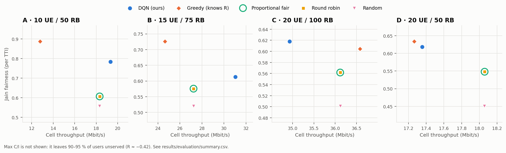
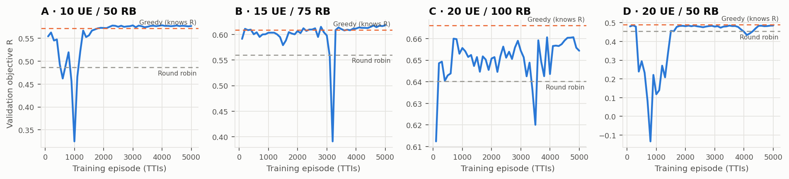

# Results

Every number on this page comes from `drl5g evaluate`, run on the committed
models. That is 4 scenarios × 6 schedulers × **500 cell layouts** (5 seeds ×
100 UE drops), with each drop simulated for 200 TTIs. All schedulers see the
same drops, so differences between them are paired. The raw data is in
[`results/evaluation/episodes.csv`](../results/evaluation/episodes.csv) (one
row per episode) and
[`summary.csv`](../results/evaluation/summary.csv). The setup is described in
[METHODOLOGY.md](METHODOLOGY.md).

## Headline

`R` is the mean per-TTI objective (higher is better). The last column is the
paired difference over the shared drops with its 95 % confidence interval.

| Scenario | Round robin | Prop. fair | Greedy (knows R) | **DQN** | DQN vs round robin | DQN − Greedy (paired) |
|---|---|---|---|---|---|---|
| A | 0.486 | 0.486 | 0.572 | **0.579** | +19.0 % | +0.0073 ± 0.0024 |
| B | 0.560 | 0.560 | 0.609 | **0.614** | +9.6 % | +0.0052 ± 0.0021 |
| C | 0.640 | 0.640 | **0.666** | 0.658 | +2.8 % | -0.0081 ± 0.0009 |
| D | 0.455 | 0.455 | **0.490** | 0.483 | +6.3 % | -0.0066 ± 0.0005 |

* **The DQN beats every scheduler that does not know the reward function, in
  every scenario.** Its gain over round robin and proportional fair is
  +2.8 % to +19.0 %. The smallest paired difference (C vs round robin,
  +0.018) is still 17 times its 95 % half-width.
* **It is level with a greedy allocator that evaluates `R` in closed form.**
  The DQN is ahead in A and B (+1.3 % and +0.8 %, both significant) and behind
  in C and D (−1.2 % and −1.3 %). The greedy reference decides one RB group at
  a time at the same granularity, but it computes the exact gain of every
  option. The DQN has to learn those gains from rewards.
* **Proportional fair equals round robin.** With a static channel, PF
  converges to equal RB shares, which is exactly what round robin hands out.
  The two differ only in the fourth decimal in D.
* **Max C/I scores R ≈ −0.42.** It carries 53–128 Mbit/s but leaves 90–95 % of
  the users with nothing, which the minimum-service term punishes. It is
  omitted from the figures so the axes can show the differences that matter.

### Where the schedulers sit on the trade-off

The DQN does not just imitate the greedy rule. In A and B it reaches a higher
objective with a different mix: more throughput (A: 19.3 vs 12.8 Mbit/s) and
less fairness (A: Jain 0.78 vs 0.89). One plausible reading: greedy takes
whatever raises `R` most for the next group, and early in a TTI that is
nearly always a fairness gain. The DQN values the whole TTI, so it can
accept a smaller immediate gain for a better end state. In C and D, where
the greedy rule is hard to beat, the DQN lands almost on top of it.

### Learning curves

Validation objective of the greedy policy on 128 fixed drops, every 100
training episodes. The early dips fall in the high-exploration phase (ε
decays from 1.0 to 0.02 over the first 3000 episodes). The checkpoint keeps
the best validated weights. One training run (5000 TTIs) took 10–20 minutes
on an 8-core laptop CPU, with 5–7 runs sharing it.

## Full tables

"Jain (long-term)" is computed over each UE's episode-average throughput.
"Worst UE" is the worst-served UE's average throughput. "UEs starved" is the
share of UEs that received nothing for the entire episode.

### A · 10 UEs, 50 RBs

| Scheduler | R ± 95 % CI | Throughput (Mbit/s) | Jain (per TTI) | Jain (long-term) | Worst UE (Mbit/s) | UEs starved |
|---|---|---|---|---|---|---|
| DQN (ours) | 0.5790 ± 0.0033 | 19.34 | 0.784 | 0.784 | 0.60 | 0.0 % |
| Greedy (knows R) | 0.5717 ± 0.0037 | 12.79 | 0.888 | 0.888 | 0.66 | 0.0 % |
| Proportional fair | 0.4864 ± 0.0057 | 18.32 | 0.606 | 0.606 | 0.48 | 0.0 % |
| Round robin | 0.4864 ± 0.0057 | 18.32 | 0.606 | 0.606 | 0.48 | 0.0 % |
| Random | 0.4565 ± 0.0048 | 18.32 | 0.557 | 0.606 | 0.48 | 0.0 % |
| Max C/I | -0.4209 ± 0.0083 | 53.40 | 0.100 | 0.100 | 0.00 | 90.0 % |

### B · 15 UEs, 75 RBs

| Scheduler | R ± 95 % CI | Throughput (Mbit/s) | Jain (per TTI) | Jain (long-term) | Worst UE (Mbit/s) | UEs starved |
|---|---|---|---|---|---|---|
| DQN (ours) | 0.6139 ± 0.0053 | 31.03 | 0.613 | 0.613 | 0.35 | 0.0 % |
| Greedy (knows R) | 0.6088 ± 0.0057 | 24.63 | 0.726 | 0.726 | 0.35 | 0.0 % |
| Proportional fair | 0.5601 ± 0.0067 | 27.23 | 0.576 | 0.576 | 0.46 | 0.0 % |
| Round robin | 0.5601 ± 0.0067 | 27.23 | 0.576 | 0.576 | 0.46 | 0.0 % |
| Random | 0.5265 ± 0.0060 | 27.23 | 0.520 | 0.575 | 0.46 | 0.0 % |
| Max C/I | -0.4071 ± 0.0026 | 90.53 | 0.067 | 0.067 | 0.00 | 93.3 % |

### C · 20 UEs, 100 RBs

| Scheduler | R ± 95 % CI | Throughput (Mbit/s) | Jain (per TTI) | Jain (long-term) | Worst UE (Mbit/s) | UEs starved |
|---|---|---|---|---|---|---|
| DQN (ours) | 0.6580 ± 0.0066 | 34.93 | 0.618 | 0.618 | 0.37 | 0.0 % |
| Greedy (knows R) | 0.6661 ± 0.0066 | 36.58 | 0.604 | 0.604 | 0.36 | 0.0 % |
| Proportional fair | 0.6402 ± 0.0069 | 36.12 | 0.562 | 0.562 | 0.45 | 0.0 % |
| Round robin | 0.6402 ± 0.0069 | 36.12 | 0.562 | 0.562 | 0.45 | 0.0 % |
| Random | 0.6029 ± 0.0063 | 36.12 | 0.501 | 0.561 | 0.44 | 0.0 % |
| Max C/I | -0.4253 ± 0.0005 | 128.24 | 0.050 | 0.050 | 0.00 | 95.0 % |

### D · 20 UEs, 50 RBs (resource-scarce)

| Scheduler | R ± 95 % CI | Throughput (Mbit/s) | Jain (per TTI) | Jain (long-term) | Worst UE (Mbit/s) | UEs starved |
|---|---|---|---|---|---|---|
| DQN (ours) | 0.4830 ± 0.0044 | 17.36 | 0.619 | 0.619 | 0.20 | 0.0 % |
| Greedy (knows R) | 0.4896 ± 0.0043 | 17.27 | 0.634 | 0.634 | 0.18 | 0.0 % |
| Proportional fair | 0.4546 ± 0.0044 | 18.06 | 0.548 | 0.562 | 0.22 | 0.0 % |
| Round robin | 0.4545 ± 0.0045 | 18.06 | 0.548 | 0.562 | 0.22 | 0.0 % |
| Random | 0.3292 ± 0.0037 | 18.06 | 0.451 | 0.562 | 0.22 | 0.0 % |
| Max C/I | -0.4468 ± 0.0043 | 64.12 | 0.050 | 0.050 | 0.00 | 95.0 % |

## Robustness to the training seed

Scenario A trained three times with different seeds (`drl5g train a --seed N`)
and evaluated on the same 500 drops:

| Training seed | R ± 95 % CI | DQN − Greedy (paired) |
|---|---|---|
| 0 (committed model) | 0.5790 ± 0.0033 | +0.0073 ± 0.0024 |
| 1 | 0.5776 ± 0.0034 | +0.0059 ± 0.0026 |
| 2 | 0.5799 ± 0.0033 | +0.0082 ± 0.0025 |

The spread across seeds (0.0023) is smaller than the evaluation CI, and all
three runs beat the greedy reference significantly. Only scenario A was
repeated; for B–D a single seed is reported.

## Ablation: the original objective rewards starvation

The course version scored schedulers with `R = α·min(T/T₀, 1) + β·J`, without
the minimum-service term (`λ = 0`). The same agent trained on that objective
for scenario A gives:

| Scheduler | R ± 95 % CI | Throughput (Mbit/s) | Jain (per TTI) | Jain (long-term) | Worst UE (Mbit/s) | UEs starved |
|---|---|---|---|---|---|---|
| DQN (ours) | 0.5945 ± 0.0037 | 28.65 | 0.628 | 0.628 | 0.39 | 21.0 % |
| Greedy (knows R) | 0.5755 ± 0.0036 | 14.24 | 0.872 | 0.872 | 0.63 | 2.8 % |
| Proportional fair | 0.4864 ± 0.0057 | 18.32 | 0.606 | 0.606 | 0.48 | 0.0 % |
| Round robin | 0.4864 ± 0.0057 | 18.32 | 0.606 | 0.606 | 0.48 | 0.0 % |
| Random | 0.4616 ± 0.0048 | 18.32 | 0.557 | 0.606 | 0.48 | 0.0 % |
| Max C/I | 0.4791 ± 0.0083 | 53.40 | 0.100 | 0.100 | 0.00 | 90.0 % |

* **The DQN learns to drop cell-edge users.** On average 21 % of them get
  nothing for a whole episode. That is how it scores the highest `R`: the RBs
  they would need buy more throughput elsewhere, and Jain's index barely
  notices a user at zero.
* **Under this objective, Max C/I (90 % of users starved) scores about the
  same as round robin**, a sign that the objective, not the agent, is at
  fault.
* With `λ = 1` (the committed scenarios), no scheduler except Max C/I starves
  anyone, and the DQN keeps its lead over the greedy reference in A.

To reproduce: copy `configs/scenario_a.yaml` to `configs/scenario_a0.yaml`,
set `name: A0` and `starvation_penalty: 0.0`, then run `drl5g train a0` and
`drl5g evaluate --scenarios a0`.

## Cross-scenario transfer

The equivariant Q-network has the same weights for any number of UEs, so a
model trained on one scenario can run on another. Models trained with 2-RB
groups (A and D) were swapped between the two 50-RB scenarios:

| Model → scenario | DQN R | Greedy | Round robin | UEs starved (DQN) |
|---|---|---|---|---|
| A → A (native) | 0.579 | 0.572 | 0.486 | 0.0 % |
| D → A | 0.556 | 0.572 | 0.486 | 0.0 % |
| D → D (native) | 0.483 | 0.490 | 0.455 | 0.0 % |
| A → D | 0.437 | 0.490 | 0.455 | 2.4 % |

Transfer is asymmetric. The model trained under scarcity (D, 2.5 RBs per UE)
carries over to the roomier cell and still beats round robin by 14 %. The
model trained with plenty of RBs (A) never learned to ration them: in D it
falls below round robin and starts leaving users unserved. Reproduce with
`drl5g evaluate --scenarios d --checkpoint results/models/scenario_a/model_final.pth`
and the reverse.

## What these results do not show

* **A static channel favours the greedy reference.** With fading and
  long-term fairness, a one-step rule is myopic in time as well as within the
  TTI. That is where learning should pay off most, and it is the natural next
  experiment.
* **A deployable scheduler would need more.** The greedy reference and the
  DQN both optimise a known per-TTI objective with full-buffer traffic. Real
  schedulers also handle queues, HARQ, CQI reporting delay and per-UE QoS
  classes.
* **Training variance was measured only for scenario A.**
